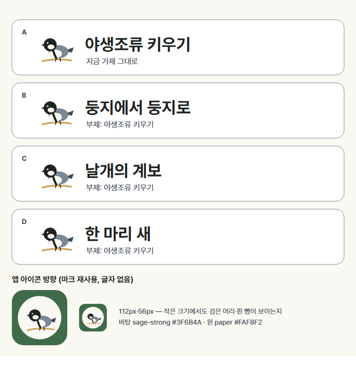

# 게임 정식 이름·로고 시안

> 소유: 아트·UX. **상태: 시안 v0 (2026-10-16) — 대표 결정 대기(`needs:ceo`, #538).** 결정 전까지 화면·매니페스트 이름은 지금 가제 「야생조류 키우기」 그대로 둔다.
> 근거: 기획서 15장 미결 8 · 로드맵 M3 아트 산출물 · `docs/agents/art.md` L3(정식 이름·로고는 대표 결정).

원본: [`name-logo/sheet.svg`](name-logo/sheet.svg)(시트) · [`name-logo/mark.svg`](name-logo/mark.svg)(마크). PNG는 Pretendard로 그린 미리보기.

## 1. 이름 후보

| | 이름 | 무엇을 앞세우나 | 좋은 점 | 걸리는 점 |
|---|---|---|---|---|
| A | 야생조류 키우기 | 장르(육성) | 무엇을 하는 게임인지 바로 앎 · 바꿀 것 없음 | 설명문 같아 기억에 덜 남음 |
| **B (추천)** | **둥지에서 둥지로** | 세대 계승(가문) | 게임의 끝맺음(번식 → 새끼에게 계승)을 한 줄로 · 부르기 쉬움 | 육성인 줄은 부제가 알려 줘야 함 |
| C | 날개의 계보 | 가계도·혈통 | 커리어·가문 느낌 | 무겁고, 판타지 게임처럼 들릴 수 있음 |
| D | 한 마리 새 | 한 개체의 일생 | 차분한 도감 화풍과 맞음 | 짧아 검색이 어려움 |

- B·C·D는 **부제 「야생조류 키우기」**를 붙여 검색·설명을 지금 가제가 맡는다(앱 짧은 이름은 본 이름).
- 상표·같은 이름 게임 검색은 하지 않았다(친구 공유용 취미 프로젝트, 기획서 1.3). 대표가 고른 뒤 필요하면 확인.

## 2. 로고

- **워드마크**: Pretendard Bold, `ink` #1F2421, `paper` 위. 새 글꼴을 들이지 않는다(라이선스·용량, style-guide 5.4).
- **마크 M1**: 박새 옆모습 평면 벡터 — 검은 머리·흰 뺨·가슴 검은 띠(박새 식별 특징 셋)·`ochre` 가지. 색은 토큰 다섯 개만. 그림(수채)이 아니라 UI 층과 같은 평면 벡터로 둬서 아이콘·스플래시에 그대로 쓴다.
- 배치: 마크 왼쪽 + 이름 오른쪽(가로형). 세로형(마크 위·이름 아래)은 스플래시용으로 결정 뒤 만든다.

## 3. 앱 아이콘·스플래시 방향 (결정 뒤 만든다)

- 아이콘: `sage-strong` #3F6B4A 둥근 네모 + `paper` 원 + 마크. **글자 없음**. 시트의 56px에서도 검은 머리·흰 뺨이 보인다.
- 지금 `apps/web/public/icon.svg`(클라이언트 임시 아이콘)는 결정 뒤 이 마크로 바꾸도록 클라이언트에 이슈로 넘긴다(192·512 PNG, maskable 여백 포함).
- 스플래시: `paper` 바탕 + 세로형 로고. PWA 스플래시는 매니페스트 `background_color`·아이콘으로 만들어지므로 별도 그림은 만들지 않는다.

## 4. 결정 뒤 할 일
1. 고른 이름으로 시트 정리(가로·세로형 로고 SVG를 `assets/logo/`에) — 아트
2. 클라이언트에 매니페스트 `name`·`short_name`·아이콘 교체 이슈 — 아트 → 클라이언트
3. 기획서 15장 미결 8 닫기 — 게임디자인에 알림
